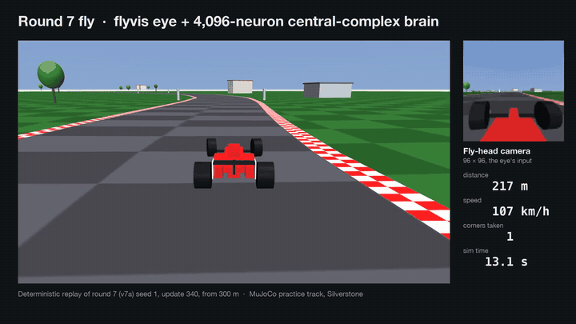
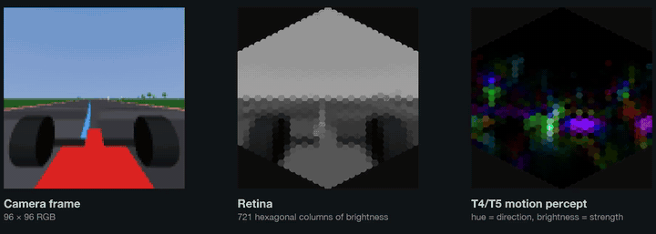
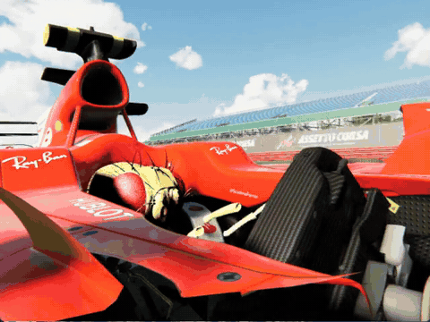
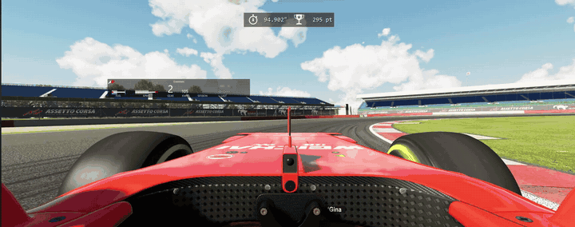
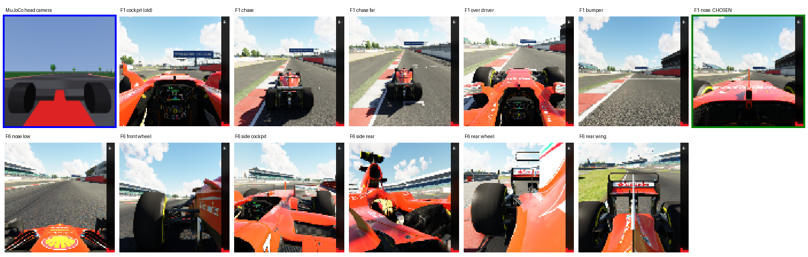

<h1 align="center">Formula Fly</h1>

<p align="center">
  <b>A simulated fruit fly learns to drive a Formula car at Silverstone,<br>
  seeing the track through a visual system wired from the real fly connectome.</b><br>
  CSCI 4220 Machine and Deep Learning, California Baptist University, Fall 2026.
</p>

<p align="center">
  <a href="#quick-start"><b>Quick start</b></a>
  &nbsp;·&nbsp;
  <a href="#results-so-far">Results</a>
  &nbsp;·&nbsp;
  <a href="#how-it-works">How it works</a>
  &nbsp;·&nbsp;
  <a href="#research-questions">Research questions</a>
</p>

<p align="center">
  <a href="https://github.com/cbu-machine-and-deep-learning-26/formula-fly/actions/workflows/ci.yml"></a>
  
  
  <a href="LICENSE"></a>
</p>

<p align="center">
  
</p>

## What is this

A software version of a tethered-fly rig. A virtual fruit fly sees a race track through
[flyvis](https://github.com/TuragaLab/flyvis), a model of the fly optic lobe wired from the
[FlyWire](https://codex.flywire.ai) connectome. A brain model turns that activity into steer,
throttle and brake, and the fly learns to drive by reinforcement learning (PPO).

The demo is a fly driving a Formula car in Assetto Corsa. The science is a comparison: does wiring
copied from a real fly help a network learn to drive, hurt it, or not matter, against
unconstrained networks of the same size? Everything is simulation. There is no hardware, no
animal and no real car.

## Results so far

> **Work in progress, as of Oct 24, 2026.** The fly has not completed a lap yet.

The current driver is round 7 ("v7a"): the frozen flyvis eye, a 4,096-neuron central-complex
brain and a PPO policy head, rewarded for pace and paid a bonus for each corner it completes.

| Measure (MuJoCo practice track, Silverstone, lap = 5,887 m) | Round 7 |
|---|---|
| Best single drive | about 4,400 m (about 75% of a lap) |
| Top speed on that drive | about 130–140 km/h |
| Best 50-drive average | 1,308 m |
| Full laps | none yet |
| Crashes at the four braking zones (Maggotts, Vale, Brooklands, Stowe) | 58% |

Each round fixed a shortcut the previous reward left open. Paid for distance, the fly crawled.
Charged for time, it stopped. Paid for pace with crash and stall penalties, it raced. Paid a
bonus per corner, it started to brake. Every round warm-starts from the previous round's best
checkpoint.

| Round | Change | Best drive |
|---|---|---|
| r1 | Eye + brain, starts on the grid | 577 m |
| r2 | Random start positions round the lap | 1,056 m |
| r3 | Lap-time reward | collapsed: it learned to stop |
| r4 | Pace reward | 2,800 m |
| r5 | Crash penalty, slow rule, warm start | 3,405 m |
| r6 | Gentler PPO updates | 4,448 m |
| r7 | Corner bonus | about 4,400 m |

### What the fly sees

<p align="center">
  
</p>

Left to right: the 96×96 head camera at 50 Hz, the same frame resampled onto flyvis's 721
hexagonal columns, and the response of the T4/T5 motion detectors (hue is direction, brightness
is strength). The policy reads 5,768 T4/T5 features.

### Assetto Corsa

<table>
  <tr>
    <td width="40%"></td>
    <td width="60%"></td>
  </tr>
  <tr>
    <td>The fly in the cockpit, animated live from its brain.</td>
    <td>A human lap at Silverstone, the data the fly learns to copy.</td>
  </tr>
</table>

The fly drives the Formula car in Assetto Corsa through the AC bridge. Pure RL in Assetto Corsa
plateaued, because the realistic graphics look nothing like the flat-shaded practice track to a
frozen eye. So the AC driver now starts from the MuJoCo brain and is behaviour-cloned on human
laps, re-rendered through the fly's own nose camera
([docs/assetto-corsa-training.md](docs/assetto-corsa-training.md#behaviour-cloning-on-human-laps)).

<p align="center">
  
</p>

The AC camera was chosen to match the practice track: the nose camera (green) is the closest of
AC's eleven views to the MuJoCo head camera (blue), and has no steering wheel in view.

## Quick start

The practice track runs on Windows, Linux and macOS. [RUNNING.md](RUNNING.md) has the setup for
each platform, plus the controls.

```bash
git clone https://github.com/cbu-machine-and-deep-learning-26/formula-fly.git
cd formula-fly
python -m venv .venv
.venv/bin/python -m pip install -e ".[dev]"   # Windows: .venv\Scripts\python.exe
.venv/bin/python scripts/drive.py             # macOS: .venv/bin/mjpython
```

Lap times land in [lap_times.md](lap_times.md).

Train the fly:

```bash
python scripts/train.py --seed 0      # frozen flyvis eye + PPO head on the practice track
```

One YAML file is one condition (eye type, brain, frozen or fine-tuned, seeds 0, 1 and 2). Every
run writes per-term rewards to CSV, and W&B is opt-in. [docs/training.md](docs/training.md) has
the config reference, the outputs and which virtualenv to run it from.

## How it works

```
Eye (connectome visual system) → Brain (central complex / whole-brain model)
    → Body (MuJoCo fly) → Car (sim racer)
```

The driver used in the results above:

```
96×96 camera frame (50 Hz) → hex resampler (721 columns) → flyvis eye (frozen)
  → T4/T5 motion features (5,768) → central-complex brain (4,096 neurons)
  → policy head (MLP 64×64) → steer, throttle, brake
```

- **Eye.** flyvis, the pretrained optic lobe from Lappalainen et al.: about 45,000 neurons in 64
  cell types and 721 hexagonal columns, wired from FlyWire. It is frozen, so it stays
  biologically valid.
- **Brain.** A sparse central-complex-style rate network of 4,096 neurons with 130,332 trainable
  weights, about 310× fewer than a dense network of the same width. Its wiring is modelled on
  the fly's navigation centre but is synthetic, not yet copied from FlyWire.
- **Body.** flybody, tethered: wings steer and legs on a trackball give throttle. Direct drive
  skips it.
- **Car.** A MuJoCo practice track built from Silverstone's centreline with a first-person
  camera at the fly's head, and Assetto Corsa for the demo.

One interface ties the stages together: a camera frame in, a control vector
`(steer, throttle, brake)` out. Every stage can be swapped for a simpler stand-in, and no track
blocks another. The contract is code, not prose:
[`fly_driver/interface.py`](fly_driver/interface.py) holds the types, ranges and the
`Eye` / `Policy` / `Body` / `Driver` protocols, and
[`fly_driver/drivers.py`](fly_driver/drivers.py) composes them into `DirectDriveAgent` (no body)
and `EmbodiedDriveAgent` (the fly in the loop).

The practice track uses a first-person view on purpose. flyvis models motion vision, so the eye
needs to see the scene expand when the car accelerates and flow sideways when it turns. A
top-down view gives it neither.

## Research questions

A connectome is a wiring diagram, not a trained model. We keep that topology fixed and train the
encoding, the decoding and optionally the synapse strengths. Each rung is a complete result.

1. **RQ1.** Can a connectome-constrained visual system learn to drive, and does the constraint
   help, hurt or not matter against matched-size controls: a small CNN eye, a random-projection
   eye and a degree-matched shuffled connectome?
2. **RQ2.** Does a whole-brain connectome model learn to drive with fewer trainable parameters
   than a blank network?
3. **RQ3.** Which neurons does driving need? Silence one cell type at a time and build a lesion
   map.
4. **RQ4.** Does driving training keep the model biologically faithful, compared against real
   fly recordings?
5. **RQ5 (stretch).** The fly body on the controls, and wheel-to-wheel racing.

## Stack

| Piece | Source |
|---|---|
| Wiring | [FlyWire](https://codex.flywire.ai) adult female brain connectome (Dorkenwald et al., Nature 2024) |
| Eye | [flyvis](https://github.com/TuragaLab/flyvis) optic lobe (Lappalainen et al., Nature 2024) |
| Whole brain | Shiu et al., Nature 2024 (LIF / FlyWire) |
| Body | [flybody](https://github.com/google-deepmind/flybody) (Vaxenburg et al., Nature 2025) |
| Car (demo) | [AssettoCorsaGym](https://github.com/dasGringuen/assetto_corsa_gym) (Remonda et al., NeurIPS 2024) |
| Car (science) | MuJoCo practice track, our own, built from the Silverstone centreline |
| Physics | [MuJoCo](https://github.com/google-deepmind/mujoco) (Google DeepMind, Apache 2.0) |
| Track geometry | [TUMFTM racetrack-database](https://github.com/TUMFTM/racetrack-database) (LGPL-3.0) |
| Learning | PyTorch, PPO (CleanRL-style, `fly_driver/training/ppo.py`) |

We use FlyWire, not MaleCNS, because flyvis and the Shiu whole-brain model are built on FlyWire.

## Documentation

| Doc | What it covers |
|---|---|
| [RUNNING.md](RUNNING.md) | Setup, controls and lap times for the practice track |
| [docs/training.md](docs/training.md) | PPO training, configs, rewards and warm starts |
| [docs/running-the-stacks.md](docs/running-the-stacks.md) | Each stack on its own |
| [docs/evaluation-harness.md](docs/evaluation-harness.md) | Eval protocol and robustness |
| [docs/midterm.md](docs/midterm.md) | The RQ1 eye comparison setup |
| [docs/assetto-corsa-bridge.md](docs/assetto-corsa-bridge.md) | Driving the AC car from the fly |
| [docs/assetto-corsa-training.md](docs/assetto-corsa-training.md) | Training and cloning in AC |
| [docs/fly-driver.md](docs/fly-driver.md) | The 3D fly in the AC cockpit |

See [CONTRIBUTING.md](CONTRIBUTING.md) for git-flow and branch names. Project context for agents
lives in [AGENTS.md](AGENTS.md) (`CLAUDE.md` is a pointer to it).

## Team

| Person | Work |
|---|---|
| Ryan Stoffel | Project lead. The brain, training and rewards, Assetto Corsa |
| Payton Henry | The MuJoCo practice track and car physics, and the fly's-eye view |
| Joey Russell | The tethered flybody body, and the Python coding standards |
| Elijah Tabor | The PPO training loop, the shared stage contract, and the fly in the AC cockpit |

Built for CSCI 4220 Machine and Deep Learning at California Baptist University, Fall 2026.

## Citations and acknowledgements

This project stands on public work. If you build on it, cite the originals:

- Dorkenwald et al., "Neuronal wiring diagram of an adult brain." *Nature* (2024). FlyWire.
- Lappalainen et al., "Connectome-constrained networks predict neural activity across the fly
  visual system." *Nature* (2024). flyvis.
- Shiu et al., "A Drosophila computational brain model reveals sensorimotor processing."
  *Nature* (2024).
- Vaxenburg et al., "Whole-body physics simulation of fruit fly locomotion." *Nature* (2025).
  flybody.
- Remonda et al., "A Simulation Benchmark for Autonomous Racing with Large-Scale Human Data."
  NeurIPS Datasets and Benchmarks (2024). AssettoCorsaGym.
- Todorov et al., "MuJoCo: A physics engine for model-based control." IROS (2012).
- TUM Institute of Automotive Technology, racetrack-database (LGPL-3.0).

Thanks to the FlyWire consortium, the Turaga Lab, Google DeepMind and HHMI Janelia, and the
AssettoCorsaGym authors for releasing their data and code.

## License

[MIT](LICENSE).
